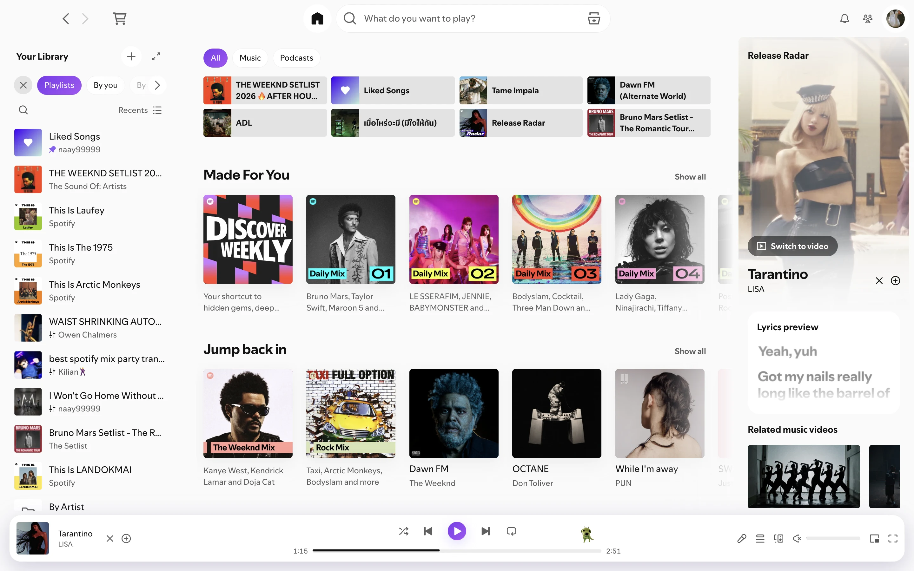
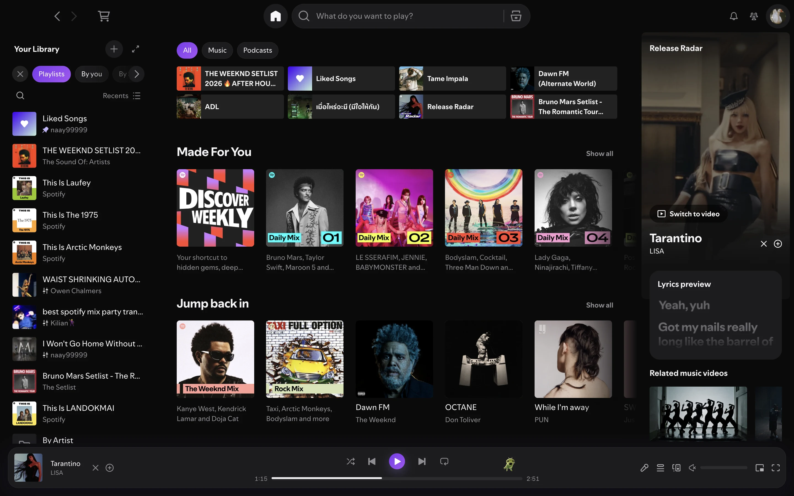
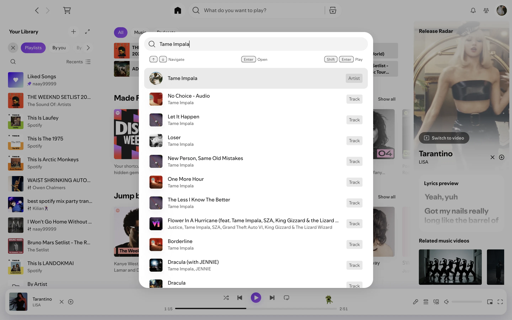
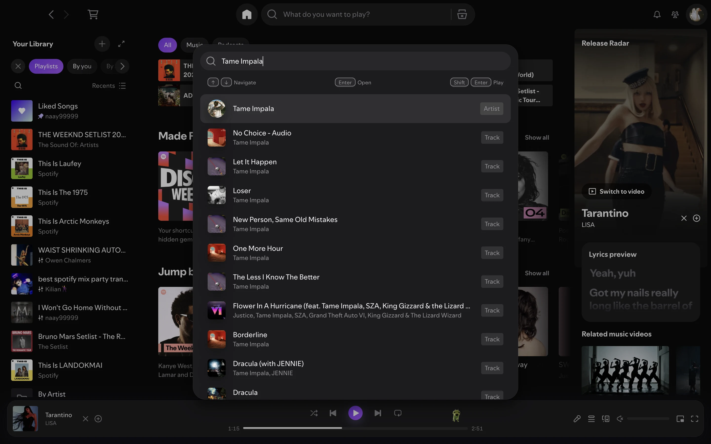

# tamjai (ตามใจ)

A Spotify theme for Spicetify with a Clean Pop design — flat platinum surfaces, rounded corners, and a soft violet gradient accent with gentle glows at a few focal points. Ships two color schemes: `suudLorLight` (soft platinum) and `suudLorDark` (near-black).

## Screenshots

| `suudLorLight` | `suudLorDark` |
| --- | --- |
|  |  |
|  |  |
|  |  |
|  |  |

Home with the Now Playing view, a playlist page, lyrics, and the Cmd+K search modal. Captured on Spotify 1.3.6 with Spicetify 2.46.4.

## Install

You need Spotify installed from [spotify.com](https://www.spotify.com/download/), opened and logged in at least once.

### With an AI agent

Clone the repo anywhere, open it in an AI coding agent — [Claude Code](https://claude.com/claude-code), Codex, or any agent that reads `.agents/skills/` or `AGENTS.md` — and ask it to install Spicetify and apply the theme. The agent follows the `tamjai-theme` skill (`.claude/skills/` and `.agents/skills/` hold the same copy): it checks what's already installed, asks before installing anything, symlinks the repo into Spicetify's Themes folder, and applies the theme.

### Manually

1. Install [Spicetify](https://spicetify.app/docs/getting-started), then run `spicetify backup apply` once.

2. Clone this theme into your Spicetify Themes folder:
   ```bash
   git clone https://github.com/naay99999/spicetify-tamjai-theme.git "$(spicetify path userdata)/Themes/tamjai"
   ```
   On Windows the folder is `%APPDATA%\spicetify\Themes\tamjai`.

3. Turn it on:
   ```bash
   spicetify config current_theme tamjai
   spicetify config color_scheme suudLorDark
   spicetify config inject_theme_js 1
   spicetify apply
   ```

4. Open Spotify — the theme loads automatically.

## Use

Switch color scheme:
```bash
spicetify config color_scheme suudLorLight && spicetify apply   # soft platinum
spicetify config color_scheme suudLorDark && spicetify apply    # near-black
```

After editing `user.css`, `theme.js`, or `color.ini`:
```bash
spicetify apply
```
If that doesn't pick up the change:
```bash
spicetify restore backup apply
```
